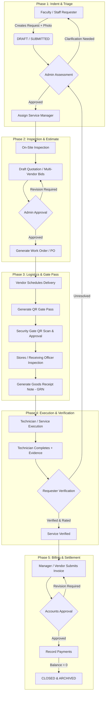

# CampusServe — Enterprise Campus Service & Procurement Management System

[](https://nodejs.org/)
[](https://expressjs.com/)
[](https://reactjs.org/)
[](https://vitejs.dev/)
[](https://www.mongodb.com/)
[](https://tailwindcss.com/)
[](LICENSE)

**CampusServe** is a full-stack, enterprise-grade campus facility maintenance, procurement, service execution, gate logistics, and financial settlement platform. Built specifically for educational institutions and multi-campus environments (supporting institutions like **MSEC**, **NEST**, **MCW**, **MSSM**, and **IIC**), CampusServe unifies the entire lifecycle of campus operations into a single auditable, transparent, and SLA-driven workflow.

---

## 📑 Table of Contents

- [Executive Overview](#-executive-overview)
- [Key Modules & Capabilities](#-key-modules--capabilities)
- [System Workflow Architecture](#-system-workflow-architecture)
- [Role-Based Access Control (RBAC) & Demo Logins](#-role-based-access-control-rbac--demo-logins)
- [Technology Stack](#-technology-stack)
- [Project Directory Structure](#-project-directory-structure)
- [Getting Started](#-getting-started)
  - [Prerequisites](#prerequisites)
  - [Installation & Environment Setup](#installation--environment-setup)
  - [Database Seeding](#database-seeding)
  - [Running the Application](#running-the-application)
- [API & Backend Architecture](#-api--backend-architecture)
- [Notifications & Multi-Channel Alerts](#-notifications--multi-channel-alerts)
- [Testing & Quality Assurance](#-testing--quality-assurance)
- [Deployment (Render & Vercel)](#-deployment-render--vercel)
- [License & Support](#-license--support)

---

## 🏛️ Executive Overview

Traditional campus operations often struggle with disconnected paper indents, delayed maintenance approvals, unverified gate entries, missing delivery evidence, and manual invoice processing. **CampusServe** solves this with an integrated, end-to-end digital pipeline:

```
[Requester Indent / Issue Report]
               │
               ▼
[Admin Review & Priority Assessment (SLA Assigned)]
               │
               ▼
[Manager Inspection ➔ Multi-Vendor Quotation Comparison]
               │
               ▼
[Work Order Execution (Technician) OR Purchase Order (Vendor)]
               │
               ▼
[Gate Pass Security (QR Scanning) ➔ Goods Receipt Note (GRN)]
               │
               ▼
[Requester Verification & Star Rating (Resolution Confirmation)]
               │
               ▼
[Accounts Invoicing & Financial Settlement (Zero Balance Tracking)]
```

Every state transition is cryptographically logged in an immutable audit ledger, accompanied by automated multi-channel notifications (In-app, Web Push, WhatsApp, and Email).

---

## ✨ Key Modules & Capabilities

### 1. 🛠️ Service Requests & Indent Lifecycle
- **Intuitive Submission**: Faculty and staff can raise service requests across categories (Electrical, Plumbing, Civil, IT Infrastructure, HVAC, Equipment).
- **Multi-Institution Support**: Manage requests across multiple campuses (`msec`, `nest`, `mcw`, `mssm`, `iic`).
- **Priority & SLA Matrix**: Dynamic SLA calculation (`LOW` 48h, `MEDIUM` 24h, `HIGH` 8h, `EMERGENCY` 2h) with automated visual escalation.
- **Evidence Management**: Secure attachment of issue photos, equipment nameplates, and initial condition documentation.
- **Admin Assessment**: Triage requests into Maintenance, Replacement, or New Purchase before manager assignment.

### 2. 💼 Quotations & Vendor Comparison
- **Multi-Vendor Bidding**: Receive and compare multiple vendor quotations per indent.
- **Detailed Cost Breakdown**: Itemized material costs, labor fees, tax rates (GST), and discounts.
- **Side-by-Side Evaluation**: Compare vendor ratings, lead times, and quotes to select the optimal bid.
- **Approval & Revision Loop**: Super Admin / Admin approval with inline revision requests.

### 3. 📋 Work Orders & Field Execution
- **Technician Dispatch**: Assign work orders to internal technicians or registered external service providers.
- **Acceptance / Decline Flow**: Technicians can review and accept work or provide decline reasons for prompt reassignment.
- **Live Progress & Material Logs**: Real-time completion percentage tracking, additional material cost requests, and blocker notes.
- **Completion Evidence**: Upload work-completed photos, warranty details, and technician sign-offs.

### 4. 📦 Procurement & Purchase Orders (PO)
- **Comprehensive PO Types**: Support for Goods POs, Service POs, and Replacement POs.
- **QR-Secured Documents**: Each PO generates an encrypted, time-validated QR token for physical gate verification.
- **Signed PO Workflow**: Vendors upload signed PO documents for administrative verification.
- **Service Provider Workspace**: External service providers log job milestones, upload receipts, and track expenses.

### 5. 🚚 Logistics, Delivery Schedules & Gate Security
- **Delivery Scheduling**: Vendors register delivery personnel, vehicles (Truck, Tempo, Van, etc.), and delivery dates.
- **Secure Gate Pass**: Dynamic QR-coded and numeric backup-coded gate passes valid for scheduled delivery windows.
- **Security Gate Scanner**: Built-in camera QR scanner and manual verification interface for gate guards.
- **Geofence Protection**: Optional geofencing verification ensuring gate scans occur physically within campus boundaries.
- **Entry & Exit Logs**: Timestamped vehicle and personnel logs with photo confirmation.

### 6. 🏢 Stores Receiving & Goods Receipt Note (GRN)
- **Physical Inspection**: Stores/Receiving Officers verify received goods against the original Purchase Order.
- **Flexible GRN Types**: Full Delivery, Partial Delivery, Rejection, and Return GRNs.
- **Damage & Rejection Tracking**: Itemized counts of accepted, damaged, and rejected items with photographic evidence.
- **Serial & Batch Numbers**: Record serial numbers, batch IDs, and warranty expiration dates.
- **Instant PDF Export**: Automatic vector PDF generation for official store records.

### 7. 💳 Invoicing, Accounts & Financial Settlement
- **3-Way Matching**: Seamless reconciliation between Purchase Order / Quotation, GRN / Completion Report, and Vendor Invoice.
- **Invoice Review & Revisions**: Multi-step submission, admin/accounts approval, and revision controls.
- **Payment Recording**: Support for Bank Transfers (NEFT/RTGS), Cheques, Credit Cards, and Cash.
- **Reconciliation Dashboard**: Track total PO value, cumulative accepted value, paid amounts, and outstanding balance due.

### 8. 🔍 Requester Verification & Quality Feedback
- **Closeout Verification**: Requester confirms whether the issue is `RESOLVED`, `PARTIALLY_RESOLVED`, or `UNRESOLVED`.
- **Quality Rating**: 1 to 5-star rating with qualitative feedback.
- **Reopen Mechanism**: Unsatisfactory resolutions can be reopened for administrative review.

### 9. 📄 Vector PDF & Report Engine
- **Pixel-Perfect Documents**: Generates official, printable vector PDF documents using PDFKit for:
  - Purchase Orders (with security QR code & signatures)
  - Work Orders & Service Reports
  - Vendor Quotation Summaries
  - Invoices & Payment Receipts
  - Goods Receipt Notes (GRN)
  - Departmental Service & Procurement Analytics

---

## 🔄 System Workflow Architecture



---

## 👥 Role-Based Access Control (RBAC) & Demo Logins

CampusServe enforces strict, role-specific navigation, permissions, and action queues. When seeding the database via `npm run seed-users`, the following default test accounts are created with password **`123`**:

| Role | Email | Department / Scope | Primary Responsibilities |
| :--- | :--- | :--- | :--- |
| **Super Admin** | `super@msec.edu.in` | `SYSTEM` | Full system control, global settings, institution management, audit logs |
| **Admin** | `admin@msec.edu.in` | `ADMIN` | Request triage, priority/SLA assignment, quote & PO approvals |
| **Service Manager** | `manager@msec.edu.in` | `MAINTENANCE` | Site inspection, quotation generation, technician dispatch, invoicing |
| **Technician** | `tech@msec.edu.in` | `ELECTRICAL` | Job acceptance, progress logging, material requests, job completion |
| **Requester** | `faculty@msec.edu.in` | `CSE` | Raise requests, attach issue photos, verify completion, rate service |
| **Accounts** | `accounts@msec.edu.in` | `ACCOUNTS` | Invoice verification, payment recording, balance reconciliation |
| **Gate Security** | `gate@msec.edu.in` | `SECURITY` | QR gate scanner, delivery verification, vehicle entry/exit logging |
| **Receiving Officer** | `receiving@msec.edu.in` | `STORES` | Physical inspection, damage reporting, Goods Receipt Note (GRN) |
| **Service Provider** | `service@msec.edu.in` | `MAINTENANCE` | External contractor portal, expense tracking, work evidence |
| **HOD (CSE)** | `hod.cse@msec.edu.in` | `CSE` | Department overview, faculty indent monitoring, departmental reports |
| **HOD (ECE)** | `hod.ece@msec.edu.in` | `ECE` | Department overview, faculty indent monitoring, departmental reports |
| **HOD (MECH)** | `hod.mech@msec.edu.in` | `MECH` | Department overview, faculty indent monitoring, departmental reports |

---

## 🛠️ Technology Stack

### Frontend
- **Framework**: [React 18](https://reactjs.org/) (Hooks, Context, Suspense)
- **Build Tool**: [Vite 4](https://vitejs.dev/) with optimized code splitting and chunking
- **Routing**: [React Router v6](https://reactrouter.com/) with role-guarded routes
- **Styling**: [Tailwind CSS 3.4](https://tailwindcss.com/) with `@tailwindcss/forms` and `@tailwindcss/container-queries`
- **Icons & Graphics**: [Lucide React](https://lucide.dev/)
- **Charts & Visualizations**: [Recharts](https://recharts.org/)
- **Virtualization**: [react-window](https://github.com/bvaughn/react-window) for high-performance list rendering
- **Signatures & QR**: HTML5 Canvas signature pad and dynamic QR code generation

### Backend & Database
- **Runtime**: [Node.js](https://nodejs.org/) (v22.x recommended)
- **Framework**: [Express 5](https://expressjs.com/) (RESTful endpoints, modular handlers)
- **Database**: [MongoDB Atlas](https://www.mongodb.com/) via [Mongoose 8](https://mongoosejs.com/)
- **Security & Headers**: [Helmet](https://helmetjs.github.io/), rate limiting (`express-rate-limit`), secure proxy support
- **Authentication**: Stateless JSON Web Tokens ([JWT](https://jwt.io/)) with bcrypt password hashing
- **File Uploads**: [Multer](https://github.com/expressjs/multer) & base64 payload processors (50MB cap)
- **Document Generation**: [PDFKit](https://pdfkit.org/) for vector PDF rendering and [ExcelJS](https://github.com/exceljs/exceljs) / [XLSX](https://github.com/SheetJS/sheetjs)

---

## 📁 Project Directory Structure

```
campusserve/
├── api/                               # Modular Express API Route Handlers
│   ├── auth.js                        # Authentication, login, JWT token generation
│   ├── users.js                       # User CRUD, role assignments, profile & signatures
│   ├── requests.js                    # Service Request lifecycle & state transitions
│   ├── quotations.js                  # Multi-vendor quotations & evaluations
│   ├── work-orders.js                 # Work order dispatch, progress & completion
│   ├── invoices.js                    # Invoicing workflows & approvals
│   ├── payments.js                    # Payment transactions & settlements
│   ├── generate-pdf.js                # PDFKit document generator (POs, Work Orders, Invoices)
│   ├── grn-export.js                  # Goods Receipt Note (GRN) PDF export
│   ├── notifications.js               # In-app notifications & Web Push subscriptions
│   ├── settings.js                    # Global system configurations & SLA policies
│   └── reports.js                     # Departmental metrics & operational reports
│
├── backend/                           # Specialized Logistics & Procurement Handlers
│   ├── vendors.js                     # Vendor management & directory
│   ├── purchase-orders.js             # Purchase Order lifecycle & QR token issuance
│   ├── service-orders.js              # Service provider workspace & expense bills
│   ├── deliveries.js                  # Delivery scheduling & pass generation
│   ├── gate.js                        # Security gate scanning & entry/exit verification
│   └── grn.js                         # Stores receiving, item acceptance & damage logs
│
├── lib/                               # Core Utilities & Services
│   ├── auth.js                        # JWT verification middleware
│   ├── mongo.js                       # MongoDB connection pooling & retry logic
│   ├── notificationService.js         # Multi-channel notification dispatcher
│   ├── emailService.js                # Resend & SMTP email transport
│   ├── gateGeofence.js                # GPS geofencing calculation utilities
│   ├── poQrToken.js                   # HMAC-SHA256 QR token generation & verification
│   ├── systemSettings.js              # Dynamic configuration cache
│   └── workflowEngine.js              # State transition validation & SLA calculation
│
├── src/                               # React Frontend Application
│   ├── components/                    # Reusable UI components
│   │   ├── Header.jsx                 # Dynamic navigation bar with active queues
│   │   ├── NotificationModal.jsx      # In-app notification center
│   │   ├── Settings.jsx               # User preferences & signature canvas
│   │   └── ErrorBoundary.jsx          # UI fault-tolerance handler
│   ├── pages/                         # Role-Specific Dashboards & Workspaces
│   │   ├── Dashboard.jsx              # Main adaptive dashboard (KPIs, action queues)
│   │   ├── Requests.jsx               # Service requests directory & filtering
│   │   ├── CreateRequest.jsx          # Indent / request creation form
│   │   ├── RequestDetails.jsx         # 360° request workspace (timeline, quotes, PO, verify)
│   │   ├── PurchaseOrders.jsx         # PO management & approval interface
│   │   ├── PurchaseOrderDetails.jsx   # PO details, QR pass, signed document verification
│   │   ├── Deliveries.jsx             # Logistics & delivery scheduling
│   │   ├── GateDashboard.jsx          # Gate security overview
│   │   ├── GateScanner.jsx            # Mobile/Web camera QR gate scanner
│   │   ├── GatePOVerification.jsx     # Manual gate code verification
│   │   ├── GRN.jsx                    # Stores receiving, damage recording & GRN generation
│   │   ├── ReceivingDashboard.jsx     # Stores intake overview
│   │   ├── AccountsDashboard.jsx      # Financial accounts overview & cash flows
│   │   ├── AccountsPayments.jsx       # Invoice settlement & payment recording
│   │   ├── Vendors.jsx                # Vendor directory & ratings
│   │   ├── ServiceDashboard.jsx       # External service provider workspace
│   │   ├── AdminUsers.jsx             # User management & role provisioning
│   │   ├── AdminSettings.jsx          # System configuration, SLAs & institutions
│   │   ├── AdminAudit.jsx             # Immutable system audit trail
│   │   └── Reports.jsx                # Operational & financial analytics
│   ├── App.jsx                        # Application root, routing & authentication context
│   ├── main.jsx                       # React DOM entry point
│   └── index.css                      # Tailwind styles & custom design tokens
│
├── models.js                          # Mongoose Schemas (User, ServiceRequest, PO, GRN, etc.)
├── server.js                          # Express Server Entry Point (CORS, Rate Limiting, Routes)
├── seed-users.js                      # Database seeding script for all roles & demo records
└── vite.config.js                     # Vite build & plugin configuration
```

---

## 🚀 Getting Started

### Prerequisites
- **Node.js**: v18.x or v22.x installed ([Download Node.js](https://nodejs.org/))
- **npm**: v9+ (packaged with Node.js)
- **MongoDB**: A free MongoDB Atlas cluster or a local MongoDB instance

---

### Installation & Environment Setup

1. **Clone the repository**:
   ```bash
   git clone https://github.com/princekumar-dev/Campus-servre--2.git
   cd Campus-servre--2
   ```

2. **Install dependencies**:
   ```bash
   npm install
   ```

3. **Configure Environment Variables**:
   Create a `.env` file in the root directory (refer to `.env.example`):
   ```env
   # Application Environment
   NODE_ENV=development
   PORT=3001
   PUBLIC_BASE_URL=http://localhost:3000
   FRONTEND_URL=http://localhost:3000

   # Database Connection
   MONGODB_URI=mongodb+srv://<username>:<password>@cluster.mongodb.net/campusserve?retryWrites=true&w=majority

   # Authentication & Token Security
   JWT_SECRET=replace_with_a_secure_jwt_secret_key_minimum_32_characters
   PO_QR_SECRET=replace_with_a_secure_qr_secret_key_minimum_32_characters

   # Web Push Notifications (Optional)
   VAPID_PUBLIC_KEY=your_vapid_public_key
   VAPID_PRIVATE_KEY=your_vapid_private_key

   # WhatsApp Messaging via Evolution API (Optional)
   EVOLUTION_API_URL=https://your-evolution-api.example.com
   EVOLUTION_API_KEY=your_api_key
   EVOLUTION_INSTANCE_NAME=campusserve-notifications

   # Email Alerts via SMTP or Resend (Optional)
   RESEND_API_KEY=
   RESEND_FROM=
   SMTP_HOST=smtp.gmail.com
   SMTP_PORT=587
   SMTP_USER=your-email@msec.edu.in
   SMTP_PASS=your-app-password
   SMTP_FROM="CampusServe System <noreply@msec.edu.in>"
   ```

---

### Database Seeding

Populate the database with default administrative accounts, technicians, requesters, vendors, and sample service requests:

```bash
# Seed initial users and demo records
npm run seed-users

# Ensure Super Admin account is present
npm run ensure-super-admin
```

---

### Running the Application

You can run both the frontend and backend servers simultaneously or in separate terminal tabs:

**Option A: Run Both Concurrently (Recommended)**
```bash
npm run dev:full
```

**Option B: Run Separately**
```bash
# Terminal 1: Start Express API Server (Port 3001)
npm run server:dev

# Terminal 2: Start Vite Frontend (Port 3000)
npm run dev
```

Once started:
- **Frontend Web UI**: [http://localhost:3000](http://localhost:3000)
- **Backend API**: [http://localhost:3001](http://localhost:3001)
- **API Health Check**: [http://localhost:3001/api/health](http://localhost:3001/api/health)

---

## 🔌 API & Backend Architecture

The backend exposes a comprehensive RESTful API protected by JWT authentication and rate limiters:

| Endpoint Group | Methods | Description |
| :--- | :--- | :--- |
| `/api/auth` | `POST` | User login, token verification, password recovery |
| `/api/users` | `GET`, `POST`, `PUT`, `DELETE` | User management, profile updates, digital signatures |
| `/api/requests` | `GET`, `POST`, `PUT`, `DELETE` | Service Request creation, workflow progression, approvals |
| `/api/quotations` | `GET`, `POST`, `PUT` | Vendor quotation management, bidding comparison |
| `/api/work-orders` | `GET`, `POST`, `PUT` | Work order dispatch, technician assignment, progress updates |
| `/api/purchase-orders` | `GET`, `POST`, `PUT` | PO creation, QR code verification, signed PO management |
| `/api/deliveries` | `GET`, `POST`, `PUT` | Logistics schedules, driver/vehicle passes, gate pass generation |
| `/api/gate` | `GET`, `POST` | Gate security QR scanner validation, entry/exit logging |
| `/api/grn` | `GET`, `POST` | Goods Receipt Note creation, item acceptance, damage reporting |
| `/api/invoices` | `GET`, `POST`, `PUT` | Invoice generation, review, and multi-tier approval |
| `/api/payments` | `GET`, `POST` | Financial settlement records, balance reconciliation |
| `/api/generate-pdf` | `POST` | Dynamic vector PDF document rendering (PO, WO, Invoice, Report) |
| `/api/grn-export` | `POST` | PDF export for Goods Receipt Notes |
| `/api/notifications` | `GET`, `POST`, `PUT` | In-app alerts, read status, web-push subscriptions |
| `/api/settings` | `GET`, `PUT` | Global SLA timings, institution settings, geofencing rules |
| `/api/reports` | `GET` | Operational analytics, departmental performance metrics |

---

## 🔔 Notifications & Multi-Channel Alerts

CampusServe features an automated notification subsystem:

1. **In-App Notification Center**: Instant bell badge and dropdown modal with deep-links to the exact request or PO requiring action.
2. **Web Push Notifications**: Browser-level push alerts using Web Push & VAPID.
3. **WhatsApp Dispatch**: Automated notifications to faculty, vendors, and managers via Evolution API.
4. **Email Dispatch**: Transactional emails sent via Resend or SMTP for approvals, SLA escalations, and payment vouchers.

---

## 🧪 Testing & Quality Assurance

CampusServe includes unit, integration, and workflow tests built with [Vitest](https://vitest.dev/):

```bash
# Run all automated test suites
npm run test:run

# Run tests in interactive UI mode
npm run test:ui

# Generate test coverage report
npm run test:coverage
```

### Multi-Role Acceptance Testing Checklist
1. **Requester**: Submit a service request with an attached issue photo.
2. **Admin**: Review, triage requirement (Maintenance), approve, and assign a Manager.
3. **Manager**: Conduct inspection, add itemized quotation, and submit for approval.
4. **Admin**: Approve quotation.
5. **Manager**: Create Work Order and assign Technician.
6. **Technician**: Accept job, record 50% progress, complete work, and upload completion evidence.
7. **Requester**: Verify service, provide a 5-star rating, and confirm resolution.
8. **Manager / Vendor**: Submit Invoice.
9. **Accounts**: Review invoice, record payment with reference number, and confirm request status advances to `CLOSED` with 0 balance.

---

## 🌐 Deployment (Render & Vercel)

### Backend Deployment on [Render](https://render.com)
1. Create a new **Web Service** on Render and link your GitHub repository.
2. Set the **Build Command**: `npm install`
3. Set the **Start Command**: `npm run server`
4. Add the required Environment Variables (`MONGODB_URI`, `JWT_SECRET`, `PO_QR_SECRET`, `NODE_ENV=production`, `FRONTEND_URL=https://your-frontend.vercel.app`).
5. Render automatically handles reverse proxying (`trust proxy` is configured in `server.js`).

### Frontend Deployment on [Vercel](https://vercel.com)
1. Import the repository into Vercel.
2. Set **Framework Preset**: `Vite`.
3. Set **Build Command**: `npm run build`
4. Set **Output Directory**: `dist`
5. Configure the Environment Variable:
   ```env
   VITE_API_URL=https://your-backend-api.onrender.com
   ```

---

## 📄 License & Support

This project is licensed under the **MIT License** — see the [LICENSE](LICENSE) file for details.

### Developed By
- **Prince Kumar** — Lead Developer ([@princekumar-dev](https://github.com/princekumar-dev))
- **Institution**: Mohamed Sathak Engineering College (MSEC)
- **Website**: [https://msec.edu.in](https://msec.edu.in)

---

<div align="center">
  <sub>Built with ❤️ for Mohamed Sathak Engineering College & Partner Campuses. Empowering Campus Operations Through Technology.</sub>
</div>
